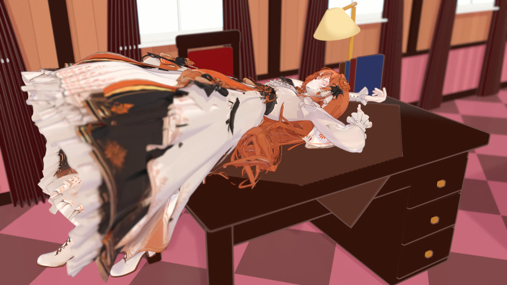
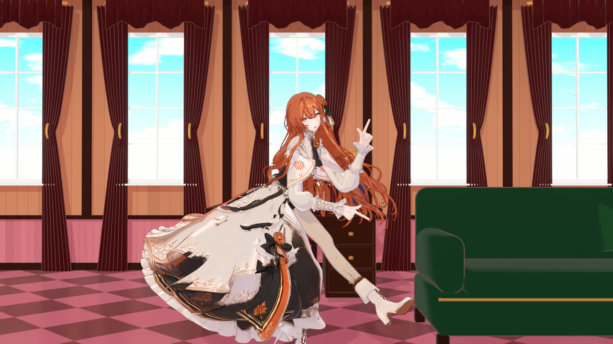
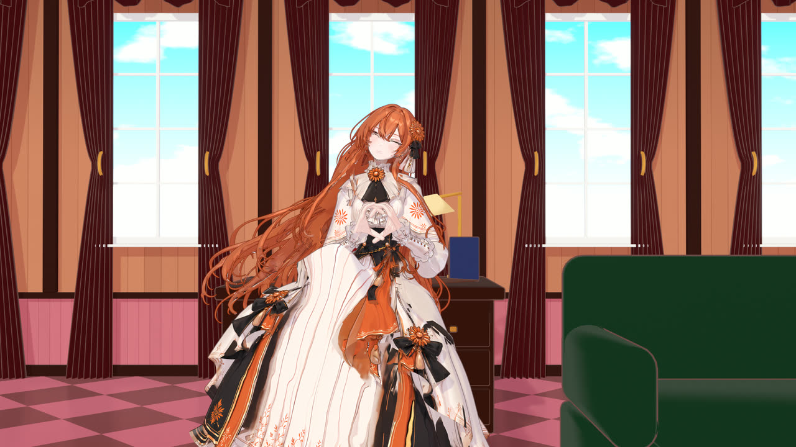

# mmdance: MMD dances on any Mixamo-rigged Blender character

[](https://github.com/starryark/mmdance/actions/workflows/tests.yml)
[](LICENSE)
[](https://www.blender.org/)
[](requirements.txt)

**mmdance makes a Mixamo-rigged character perform a MikuMikuDance (MMD) dance in Blender.** It
works with AI-generated (image-to-3D) characters from Tripo or Meshy, with Mixamo and AccuRig
rigs, or with your own rig mapped by bone name. You give it the character's `.blend` and an MMD
motion package: the VMD dance motion, the VMD camera, the facial VMD and the song. It builds the
animated scene and renders a finished 1080p video, headless, from one config file. Each step is
cached under a key of its inputs, so a rebuild recomputes only what changed and reproduces the
rest.

## Demo

https://github.com/user-attachments/assets/26e7c1ac-1053-4331-812b-8187a1a2b12a

*[projects/dreamwings](projects/dreamwings): two Tripo-generated characters, Claude and then
ChatGPT, dance 鸭梨P's MMD motion 梦的翅膀受了伤 (15 s, the meme's choreography) in the Anthropic
lobby. The lobby is appended from its own `.blend` and scaled around the dance. The camera is
solved frame by frame from the meme's reference video, whip pans and all, and the hand-off between
the two dancers is one continuous whip. Both builds start from the untouched character files: the
retargeted dance, the simulated gowns, hair, sleeves and tail, the faces, and the motion blur. Shown
as an under-10 MB copy of the 1080p render; credits in [the project](projects/dreamwings#credits-借物表).*

### The first production: Chika Dance

https://github.com/user-attachments/assets/e68a693f-9448-4adc-9f07-b09c7fcc77f6

*[projects/claude_chika](projects/claude_chika), the production mmdance was built for: a
Tripo-generated anime character in a layered ball gown dances akomni's MMD motion
チカっとチカ千花っ♡ (94 s), with the package's camera, facial track and song, in a rebuilt
student-council room. `build.py` makes the whole scene from the untouched character file: the
retargeted dance, the simulated gown and hair, the face and the stage. Shown here as a 10 MB 720p
copy of the 1080p render.*

| | | |
| --- | --- | --- |
|  |  |  |

*The opening shot, on the desk (a cloth collider); skirt physics on a kick; a smile from the
painted-face expression atlas.*

## What it does

If you have an AI-generated or auto-rigged anime character and an MMD/VMD dance you want it to
perform, this is the pipeline for that. It retargets MMD motion to a non-MMD rig, adds skirt and
hair physics, animates the face, and renders with the original camera and music. It handles:

- **Motion retargeting.** The VMD is imported with mmd_tools onto a proxy MMD skeleton built from
  your rig's proportions. It is then mapped onto your bones in world space, with twist bones shared
  between upper arm and forearm. MMD's foot IK is solved by an analytic two-bone leg IK.
- **The MMD camera** (`camera.vmd`), plus optional custom shots for stretches where the original
  camera doesn't suit your model.
- **Secondary motion** for skirts, layered gowns and aprons, long hair (as one curtain or lock by
  lock) and tails. Bone chains are laid through the mesh automatically and simulated with a
  position-based solver:
  - jointed chains with angular limits, as in MMD rigid-body skirts and DynamicBone;
  - capsule colliders measured from the body;
  - furniture box colliders and inelastic contacts.
  
  The result is baked to keyframes, so the final scene needs no add-on.
- **Facial animation** from the VMD morph track. It works on shape keys, or on a *painted* face
  texture (common for image-to-3D characters) through expression atlases built from the painting
  itself.
- **Repairs for auto-rigged meshes:**
  - rebuilding fused finger blobs as real hands from the finger bones, with the finger joints
    moved to drawn-hand proportions;
  - ripping hair from clothing, and hair curls that carry the clothing material;
  - rigid boot weights;
  - cross-side leg weight cleanup;
  - vertices left without weights.
- **Stage, lighting, render** (EEVEE), resumable parallel rendering, and encoding with the song.
  Picture and sound fade out together.
  - A set from another `.blend` scaled around the dance, a camera keyed from a track (e.g.
    solved from a reference video), a key light that follows the camera, motion blur.
  - Project code of your own on the built character (a rebuilt face, a prop, sleeves), shared
    between projects by path.
  - A packed copy of the scene for a cloud GPU, two characters' renders cut into one video, and
    copies for sharing.

Everything is generated from your untouched character file by `build.py`. Every stage caches its
results, keyed by its inputs, so a rebuild only recomputes what changed.

## Status
This was built for one production: a Tripo-generated 1 m toon character dancing a 94 s MMD motion
([projects/claude_chika](projects/claude_chika), the [Chika Dance
video](#the-first-production-chika-dance) above). The engine (retargeting, camera, chains and
physics, face states, render, encode) is generic and config-driven, and it reproduces that
production's output exactly: every cache, the face atlases and the rendered frames match. The
generic path was also smoke-tested on the same character: the default stage, a follow camera,
shape-key faces, no repairs, and a range starting mid-dance.

Since then it has made videos with three Tripo characters and two dances. Each new mesh added the
options it needed, all opt-in:
- [projects/deepseek_chika](projects/deepseek_chika): a whale maid with an apron, a tail and
  hands that share their material with her neck.
- [projects/chatgpt_chika](projects/chatgpt_chika): a dragon woman with wings, a tail and bell
  sleeves. Project code simulates the sleeves and beats the wings.
- [projects/claude_chika_v3](projects/claude_chika_v3): the first production redone, with hair
  per lock, a calmer gown, drawn-hand finger joints and a face rebuilt as geometry.
- [projects/dreamwings](projects/dreamwings): a second dance, a 15 s motion-capture meme. Claude
  and ChatGPT take turns on a set appended from another `.blend`, filmed by a camera solved from
  the reference video.

Expect to tune the lattice heights and physics for a new outfit, and the hair for a new dance.
The face atlas needs measured guide curves for each painted face; a painted face on a sculpted
head is better rebuilt as geometry (project code in
[projects/claude_chika_v3](projects/claude_chika_v3), not yet an engine mode). Stage builders,
sets and solved cameras are per project. Builds were run on Windows 11 with Blender 5.2. The
DreamWings frames were rendered on Linux, on a cloud GPU, from packed copies of the built scenes.

## Requirements
- **Blender 5.2+** with the **MMD Tools** extension (Edit › Preferences › Get Extensions ›
  "MMD Tools"; tested with 4.5.14).
- **Python 3.11+** (system) with `numpy scipy opencv-python scikit-image pillow matplotlib`. These
  run the hand and face-atlas builders (Blender's bundled Python lacks them), encoding and QA.
- **ffmpeg** on `PATH`.

```
pip install -r requirements.txt
```

## Quick start
```
python -m mmdance new projects/my_dance          # copies the template
#   character/  <- your rigged .blend (Mixamo bone names, T-pose, Z up, facing -Y)
#   source/     <- motion.vmd, camera.vmd, (facial.vmd), song.wav
python -m mmdance inspect projects/my_dance/character/character.blend   # rig check + heights + suggestions
#   edit projects/my_dance/project.toml
python -m mmdance build  projects/my_dance/project.toml
python -m mmdance stills projects/my_dance/project.toml 100,600,1200 cam,front    # quick check renders
python -m mmdance render projects/my_dance/project.toml --jobs 2
python -m mmdance encode projects/my_dance/project.toml
```
A project is one `project.toml`; [mmdance/defaults.toml](mmdance/defaults.toml) documents every key.
Put machine-specific paths in a `project.local.toml` next to it; it is merged on top and never
committed. See [docs/new-character.md](docs/new-character.md) for the walkthrough and
[docs/how-it-works.md](docs/how-it-works.md) for the methods.

## Layout
| | |
|---|---|
| `build.py` | Blender entry point: runs the stages motion → camera → rig → physics → face → stage and saves the scene |
| `mmdance/` | The pipeline: `motion` (retarget), `camera`, `rig` (chains, weights, repairs), `layers` (gown layer split), `physics` + `solver` (simulation and bake), `face` + `face_atlas`, `hands` + `hand_sdf`, `stage`, `encode`, `config`, `vmd` (parser) |
| `tools/` | `inspect_character`, `stills` (check renders), `physics_qa` (motion / hem-lag metrics), `plot_character`, `facial_vmd` (rewrite a facial track), `pack` (a copy to render elsewhere), `remote/` (a Linux GPU render machine) |
| `projects/template/` | Starting point for a new project |
| `projects/claude_chika/` | The full example: config, the room stage builder, notes and limits |
| `projects/deepseek_chika/` | A second character on the same dance: apron layer, tail chain, shared-material hands, a skirt texture cleanup, and the room lit by sunlight through its windows |
| `projects/chatgpt_chika/` | A third character: wings, tail and bell sleeves (sleeve simulation and wing beat as project code), on a model whose parts were repaired first |
| `projects/claude_chika_v3/` | The example redone: hair per lock, a calmer gown, finger joints, the cap prop, and the face rebuilt as geometry (mouth, layered eyes, shape keys) |
| `projects/dreamwings/` | A second dance with two characters taking turns, config only: a set appended from another `.blend`, a camera from a solved track, a key light following it, motion blur, the two renders cut into one video |
| `tests/` | Unit tests that run in system Python (`python -m unittest`) |

## Assets and licence
The code is MIT licensed. **No characters, motions or music are included or redistributed.** The
demo videos and the stills in `docs/media` are renders of the example projects, shown to illustrate
the pipeline; the motions and songs in them belong to their authors (see the credits of
[claude_chika](projects/claude_chika#credits) and [dreamwings](projects/dreamwings#credits-借物表)). MMD motions and songs carry their authors' terms. Read
and follow them, credit the authors, and check whether derivative videos are allowed before you
publish one. The `.gitignore` keeps `.blend`, `.vmd`, audio, video, images (apart from the docs
stills) and caches out of the repository.

## FAQ

**How do I make a Tripo, Meshy or Mixamo character dance an MMD motion in Blender?**
- **Character:** export it rigged with Mixamo bone names, in a T-pose, Z up and facing -Y, and
  save it as a `.blend`.
- **Motion:** get an MMD motion package with the dance `.vmd` and, ideally, `camera.vmd`, a
  facial `.vmd` and the song.
- **Run it:**
  1. `python -m mmdance new projects/x` starts a project.
  2. `python -m mmdance inspect <character.blend>` checks the rig and suggests settings.
  3. `build`, `render` and `encode` make the video.

  See the [walkthrough](docs/new-character.md).

**Can a VMD motion drive a non-MMD model, without converting it to PMX?**
Yes, that is what mmdance is for. The VMD is evaluated by MMD Tools on a proxy MMD skeleton built
at your rig's joint positions. The resulting world-space rotations are transferred to your bones
relative to MMD's A-pose (`motion.arm_angle`, 37° by default). MMD's foot IK is solved with an
analytic two-bone leg IK, and `motion.scale` converts MMD units to metres; by default it is worked
out from the leg length.

**Does it import PMX or PMD models?**
No. For native MMD models use [MMD Tools](https://github.com/MMD-Blender/blender_mmd_tools) or
[SekaiBlender](https://github.com/ShiJieWorld/SekaiBlender). mmdance is for characters that are
*not* MMD models.

**My rig doesn't use Mixamo bone names (VRoid/VRM, Unreal mannequin, a custom rig).**
- Set `[bones] prefix`, or map each Mixamo role to your bone in `[bones.map]`, for example
  `Hips = "pelvis"`.
- The rest pose must be a T-pose facing -Y.
- Map the deform bones. Control rigs such as Rigify's are not driven directly.

**How do I add skirt, dress or long-hair physics to an auto-rigged character for the dance?**
- Enable `[skirt]`, `[overskirt]` (a second, open gown layer) and/or `[hair]`, and give the joint
  heights (`rows_z`). `inspect` suggests them.
- Bone chains are laid through the mesh, simulated with a position-based solver (jointed chains
  with angular limits, body capsule colliders, furniture boxes), and baked to keyframes.
- Tuning is described in [how it works](docs/how-it-works.md#physics).

**How do I get blinking and lip sync from the facial VMD?**
- `face.mode = "shapekeys"` with a `map` from VMD morph names (まばたき, あ, い, う, え, お, 笑い, ...)
  to your shape keys.
- Painted-face characters (common from image-to-3D) have no shape keys. For those, `face.mode =
  "atlas"` builds blink, smile and mouth tiles from the face texture itself.
- If the painting sits on a sculpted face (a nose, lips, eye sockets), the sculpt still shows
  through drawn features: the outline catches its creases. Rebuild the face as anime models are
  built, with a geometric mouth, layered eyes and shape keys. A project-level example is
  [projects/claude_chika_v3](projects/claude_chika_v3) (`face_rebuild.py`); see
  [a new character](docs/new-character.md).
- Facial tracks made from motion capture can be wrong. One read the dancer's squinting grin as
  closed eyes on 90 % of its frames. `python -m mmdance vmd facial.vmd` shows each morph's range
  and how often it is above 0.5; write a cleaned track if it doesn't fit your character.

**The MMD camera clips into my character or frames it badly.**
Add `[[camera.shots]]`: a camera of your own over a frame range, which replaces the MMD camera
there. Without any `camera.vmd`, a front camera follows the dancer. A stage builder can also key
a camera of its own: [projects/dreamwings](projects/dreamwings) keys one solved from the dance's
reference video.

**Can I recreate a dance video, with the camera moves of the reference footage?**
- `camera.track` keys the camera on every frame from a track file: an `.npz` with frames,
  location, quaternion, lens and sensor. The track itself is solved outside mmdance, for example
  from the reference video.
- `camera.track_dancer` turns the dancer with it, for a motion capture that kept her facing the
  lens while the real camera went round her.
- [projects/dreamwings](projects/dreamwings) recreates a 15 s meme this way, on a set appended
  from another `.blend` (`stage.builder = "set"`), with motion blur.

**Can two characters dance in one video?**
They can take turns. Give each its own project on the same frames, camera and song, and render
both. In the project that encodes, `[[encode.parts]]` switches to the other's frames from a given
frame on; DreamWings cuts from Claude to ChatGPT in the middle of a whip pan. A build has one
character, so both on screen at once is not supported.

**My character has wings, sleeves or a tail.**
- A tail that is its own mesh piece gets a bone chain: `[tail] enabled = true` with a `seed`
  point near it, and `sway` for a slow swish on top of the physics.
- Anything else is project code run on the built character (`stage.steps`).
  [projects/chatgpt_chika](projects/chatgpt_chika) simulates bell sleeves (`sleeves.py`) and beats
  wings (`wings.py`) that way, reading the body track and the simulation through
  `physics.body_track()` and `physics.sim_key()`.

**My generated character's hands are fused blobs.**
`[hands] enabled = true` rebuilds them from the finger bones (implicit surface + marching cubes) in
the hands' material slot, weighted with joint blends.

**Is the output reproducible?**
Yes, by design. Each stage caches its results under a key of its inputs, so a rebuild recomputes
only what changed. The reference production rebuilds to the same caches and the same frames (±1
from the GPU). From the frames, `encode` remakes the released DreamWings video byte for byte, and
from the released videos the 720p and 10 MB copies of both productions. [AGENTS.md](AGENTS.md)
has the regression standard.

**Does it run headless, on a render server or a cloud GPU?**
Yes. Everything runs through `blender -b`. Builds have been run on Windows 11. EEVEE renders
have run on Windows 11 and on a Linux cloud GPU (an L40S on RunPod), from a packed copy of the
built scene (`python -m mmdance pack`). Headless EEVEE on Linux needs the driver's graphics
libraries: `tools/remote/setup_linux_gpu.sh` installs them, and `tools/remote/gpu_check.py` tells
whether EEVEE got the GPU or fell back to software (`llvmpipe`). See
[rendering elsewhere](docs/new-character.md#5-render). `render.engine = "CYCLES"` is accepted but
untested, and the example's toon shaders are EEVEE-only.

**How long does it take?**
For the 94 s example on the development machine:

| Step | Time |
|---|---|
| First build (physics simulation 15–20 min) | about 25 min |
| Rebuild from cache | about 4 min |
| Render at 1080p with two Blender processes | about 2 h |
| Encode | under a minute |

Motion blur makes EEVEE CPU-bound. The 15 s DreamWings clip took about 21 s a frame per Blender
process, and about 50 minutes with nine processes sharing one cloud L40S.

**Where do MMD motions come from, and can I publish the result?**
Motion authors share packages on sites such as BowlRoll and on niconico. Each package has its own
terms for use, credit and posting videos. mmdance ships no motions and no music; check the terms
before publishing a video.

**Can an AI coding agent use this repo?**
Yes. [AGENTS.md](AGENTS.md) has the commands, tests and conventions, and [llms.txt](llms.txt)
indexes the documentation for LLMs.

## Related work
- [MMD Tools](https://github.com/MMD-Blender/blender_mmd_tools): imports PMX/PMD models and
  VMD motions into Blender; mmdance uses its VMD importer.
- [CosMMD](https://github.com/CyclopsRay/CosMMD): one photo → Tripo 3D → a 12 s MMD dance clip,
  agent-guided. It focuses on preserving the character's look; it has no cloth physics, facial
  animation, camera or audio.
- [Blender VMD Retargeting](https://github.com/butaixianran/Blender-Vmd-Retargeting): an add-on
  that retargets VMD body, facial and camera motion onto Daz and Character Creator rigs.
- [SekaiBlender](https://github.com/ShiJieWorld/SekaiBlender): a Blender build for native PMX
  models, with MMD IK and Bullet physics.
- Bone-chain physics add-ons (Wiggle, Spring Bones and others) provide interactive secondary
  motion. mmdance bakes its own simulation, so builds are reproducible and run headless.
